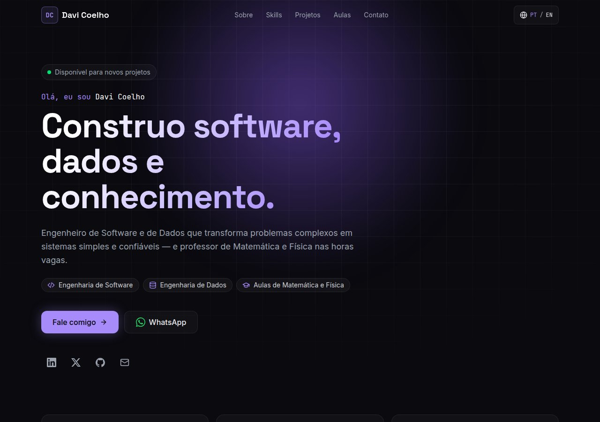
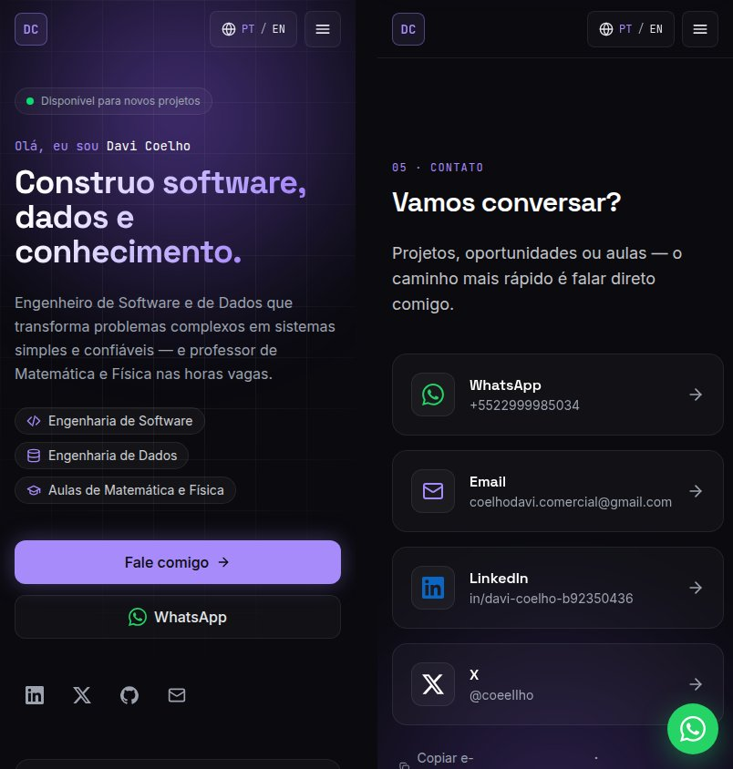

<div align="center">

# Davi Coelho — Personal Website

**Software Engineer · Data Engineer · Math & Physics Tutor**

A fast, bilingual (🇧🇷 PT / 🇺🇸 EN) one-page personal branding site with a clean, futuristic look.

[**davicoelho-comercial.vercel.app**](https://davicoelho-comercial.vercel.app)




</div>

## ✨ Features

- **Bilingual** — Portuguese at `/`, English at `/en/`, with a language switch that keeps you on the same section. Proper `hreflang` tags so search engines index both versions.
- **Mobile-first** — designed for phones first: full-screen menu, large tap targets and a floating WhatsApp button.
- **Direct contact, no forms** — one-tap WhatsApp (with a pre-filled message in the visitor's language), email (with copy-to-clipboard), LinkedIn and X.
- **Futuristic, clean design** — dark theme, violet neon accent, subtle grid and glow, glassmorphism cards.
- **Subtle motion** — scroll reveal and hover effects, fully disabled for users who prefer reduced motion.
- **Fast & static** — zero client-side framework, a few lines of vanilla TypeScript, self-hosted fonts and responsive WebP images.
- **SEO-ready** — per-language titles, descriptions and Open Graph images, JSON-LD `Person` schema and an auto-generated sitemap.

<div align="center">

</div>

## 🧭 Sections

| Section | Content |
| --- | --- |
| **Hero** | Introduction, the three pillars and quick contact buttons |
| **Sobre / About** | Photo, bio and quick facts |
| **Skills** | Languages, back-end, data and cloud tooling |
| **Projetos / Projects** | Selected projects and an experience timeline |
| **Aulas** | Math & Physics tutoring — Portuguese version only |
| **Contato / Contact** | WhatsApp, email, LinkedIn and X |

## 🛠️ Tech stack

- [Astro](https://astro.build) — static site generation and built-in i18n routing
- [Tailwind CSS v4](https://tailwindcss.com) — styling via the Vite plugin
- TypeScript (strict) — all content is typed, so both languages always have the same shape
- [Fontsource](https://fontsource.org) — self-hosted Space Grotesk, Inter and JetBrains Mono
- [Vercel](https://vercel.com) — hosting with automatic deploys on every push to `main`

## 🚀 Getting started

Requires Node.js 22.22+.

```sh
npm install
npm run dev       # dev server at http://localhost:4321
npm run build     # type-check (astro check) + static build into dist/
npm run preview   # serve the production build locally
```

## 📁 Project structure

```
src/
├── config/site.ts        # name, email, WhatsApp and social links
├── i18n/
│   ├── pt.ts             # Portuguese content
│   ├── en.ts             # English content
│   ├── types.ts          # SiteContent type shared by both languages
│   └── utils.ts          # language helpers
├── components/           # one component per section + Nav, Footer, Icon
├── layouts/Base.astro    # <head>, SEO meta tags, JSON-LD
├── pages/
│   ├── index.astro       # PT  →  /
│   └── en/index.astro    # EN  →  /en/
├── scripts/main.ts       # scroll reveal, mobile menu, copy email
├── styles/global.css     # theme tokens and shared styles
└── assets/photo.jpg      # profile photo
public/                   # favicon and Open Graph images
```

## ✏️ Editing content

All text lives in data files — components never contain hard-coded copy.

| What | Where |
| --- | --- |
| Name, email, WhatsApp, LinkedIn, X, GitHub | `src/config/site.ts` |
| Portuguese texts (bio, skills, projects, aulas) | `src/i18n/pt.ts` |
| English texts | `src/i18n/en.ts` — `tutoring: null` hides the tutoring section |
| Profile photo | `src/assets/photo.jpg` (portrait, shown in a 4:5 frame) |
| Link preview images | `public/og-pt.png`, `public/og-en.png` (1200×630) |
| Site URL | `site` in `astro.config.mjs` |

Optional fields: add `url` to a project to show a link on its card, and `company` to an experience entry to show it next to the role.

## 🌐 Deployment

The site is deployed on Vercel, connected to this repository — every push to `main` triggers a new production deploy. Astro is detected automatically (build command `npm run build`, output directory `dist`).

## 📬 Contact

- **Email:** [coelhodavi.comercial@gmail.com](mailto:coelhodavi.comercial@gmail.com)
- **LinkedIn:** [davi-coelho-b92350436](https://www.linkedin.com/in/davi-coelho-b92350436)
- **X:** [@coeeIIho](https://x.com/coeeIIho)
- **Website:** [davicoelho-comercial.vercel.app](https://davicoelho-comercial.vercel.app)
